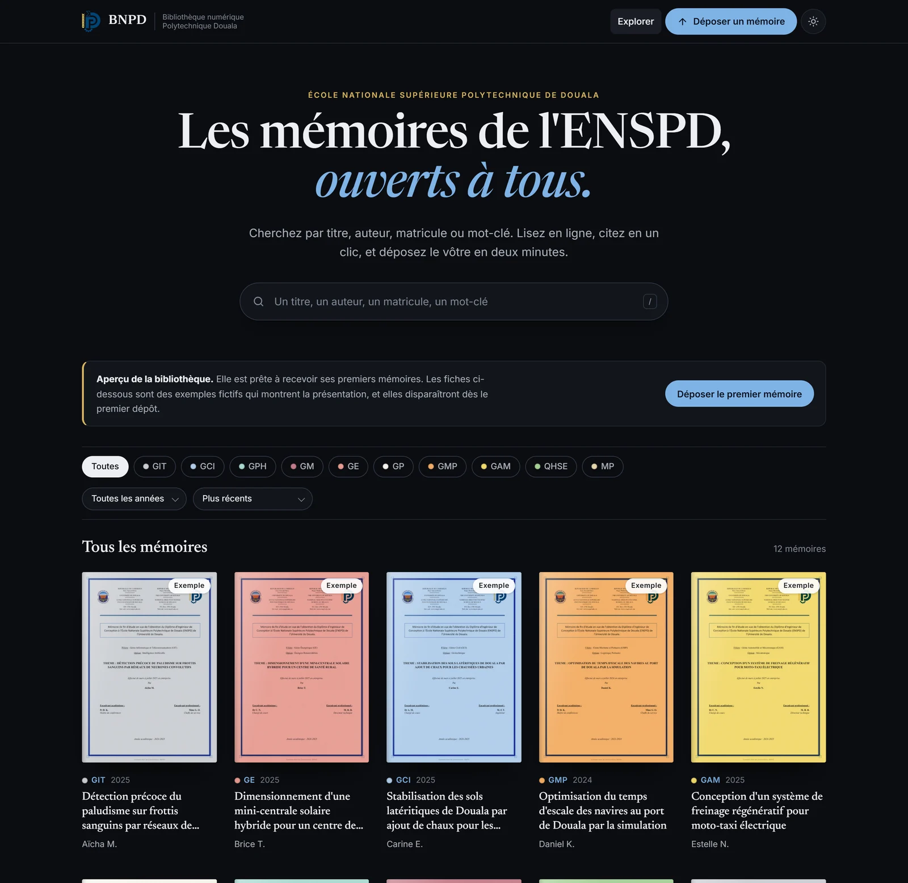
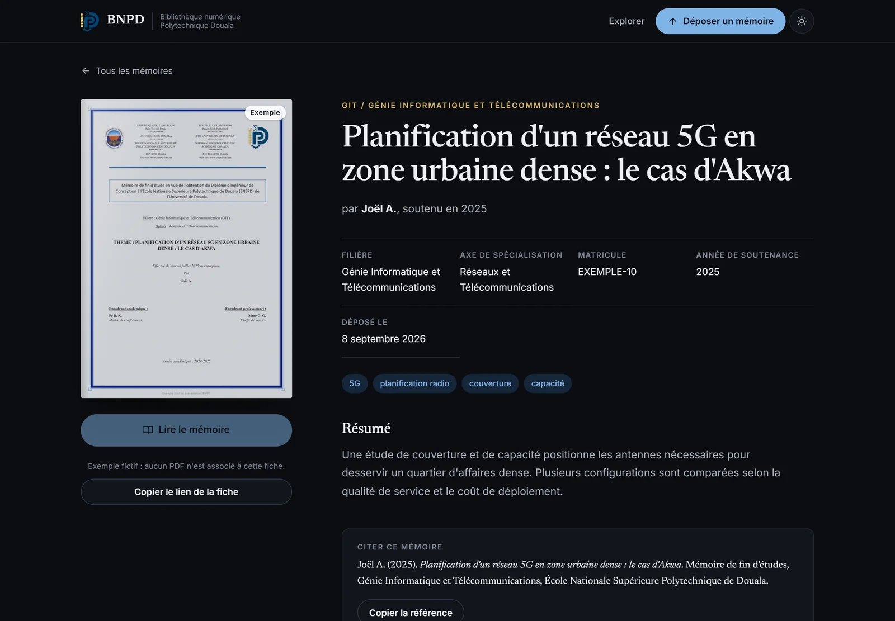
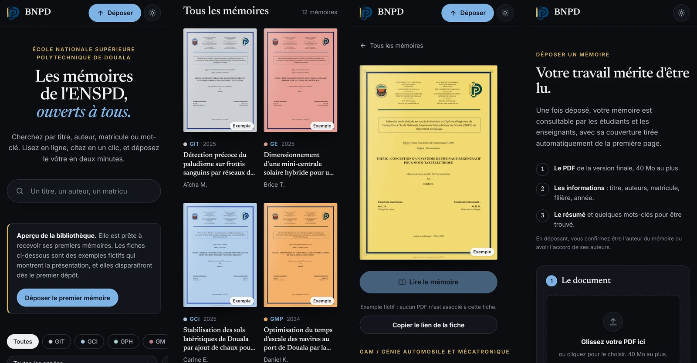

<picture>
  <source media="(prefers-color-scheme: dark)" srcset="https://raw.githubusercontent.com/lothngassa/BNPD_POLYTECHNIQUE_DOUALA/main/.github/banner-dark.svg">
  <source media="(prefers-color-scheme: light)" srcset="https://raw.githubusercontent.com/lothngassa/BNPD_POLYTECHNIQUE_DOUALA/main/.github/banner-light.svg">
  
</picture>

<br>

**BNPD** is the digital library of dissertations of the École Nationale Supérieure Polytechnique de Douala (ENSPD), in Cameroon. Students submit their final dissertation as a PDF. Anyone can then search it, read it and cite it.

**Live:** [bnpd-polytechnique-douala-v5q3.vercel.app](https://bnpd-polytechnique-douala-v5q3.vercel.app/index.html)&emsp;**API:** [BN_POLYTECHNIQUE_DOUALA_API](https://github.com/lothngassa/BN_POLYTECHNIQUE_DOUALA_API)

<picture>
  <source media="(prefers-color-scheme: dark)" srcset="https://raw.githubusercontent.com/lothngassa/BNPD_POLYTECHNIQUE_DOUALA/main/docs/accueil-sombre.webp">
  <source media="(prefers-color-scheme: light)" srcset="https://raw.githubusercontent.com/lothngassa/BNPD_POLYTECHNIQUE_DOUALA/main/docs/accueil-clair.webp">
  
</picture>

## What it does

- **Search** by title, author, student number or keyword. Filter by department and year, and sort.
- **Real covers.** The API renders the first page of each PDF. The site then prints it on the coloured card of its department, as the ENSPD dissertation guide requires: grey for GIT, blue for civil engineering, yellow for automotive, red for energy, orange for maritime, burgundy for mechanical, white for process engineering, green for QHSE.
- **A page for each dissertation** with its abstract, keywords and a citation ready to copy.
- **Submission in two minutes:** drag and drop, checks as you type, and an upload progress bar.
- **Light and dark themes**, remembered between visits, and a layout made for phones.
- **Never an empty page.** Until the first real dissertation arrives, the library shows clearly labelled fictional examples. They disappear with the first submission.

<picture>
  <source media="(prefers-color-scheme: dark)" srcset="https://raw.githubusercontent.com/lothngassa/BNPD_POLYTECHNIQUE_DOUALA/main/docs/fiche-sombre.webp">
  <source media="(prefers-color-scheme: light)" srcset="https://raw.githubusercontent.com/lothngassa/BNPD_POLYTECHNIQUE_DOUALA/main/docs/fiche-clair.webp">
  
</picture>



## How it is built

Plain HTML, CSS and JavaScript modules: no framework and no build step. Vercel deploys every push to `main`.

| File | Role |
|---|---|
| `index.html` | the library: search, filters, covers |
| `detail.html` | the page of one dissertation |
| `submit.html` | the submission form |
| `assets/app.js` | shared code: API address, departments, covers, escaping, theme |
| `assets/bnpd.css` | design system: light and dark themes, card covers |
| `assets/exemples.js` | the fictional examples shown while the library is empty |

Everything that comes from the API is escaped before it reaches the page, and only `http` and `https` links are accepted.

## Run it locally

```bash
python -m http.server 5500
```

Then open http://127.0.0.1:5500. Opened from `localhost`, the site talks to a local API on port 8000 ([how to run it](https://github.com/lothngassa/BN_POLYTECHNIQUE_DOUALA_API#run-it-locally)).

---

Built by [Loth Ngassa](https://lothngassa.com/en/). The examples in the screenshots are fictional.
